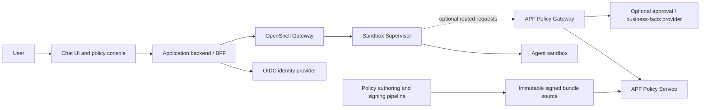

# Building a Custom Chat UI with Policy Management

**Status:** Design proposal  
**Date:** October 29, 2026

## Executive recommendation

Build the chat experience and the policy-management experience as separate application modules with a shared identity layer. Use **NVIDIA OpenShell as the initial runtime and enforcement system**. Keep **NVIDIA Agent Policy Fabric (APF) as an optional, explicitly enabled governance mode** for deployments that need centrally signed policy, provenance, or request-level authorization based on tool arguments and business facts.

The project [`shaharia-lab/openshell-webui`](https://github.com/shaharia-lab/openshell-webui) is a promising Stage 1 starting point: it already provides a browser console for OpenShell sandboxes, policies, proposals, providers, workspaces, and logs. It is an independent community project, not NVIDIA-supported, and its current security model is local-first: it has no login and anyone who can reach its port acts with the configured OpenShell gateway identity. Review its code and release before adopting or forking it, particularly before exposing it to a team.

The key architectural rule is to keep policy decisions **outside the model and chat process**. Chat code may request work and display denials or approvals, but OpenShell and, optionally, APF remain the authorities that enforce permissions.

## Goals and non-goals

### Goals

- Provide a usable chat interface for one or more agent harnesses.
- Run agents and their tools inside OpenShell sandboxes.
- Let authorized users inspect effective permissions, denials, pending access proposals, and policy history.
- Support OpenShell-managed policy as the first deployment mode.
- Add APF later without silently mixing direct policy edits with signed-bundle governance.
- Keep gateway credentials, provider secrets, and policy-signing keys out of browser code and agent context.

### Non-goals for the first release

- Replacing OpenShell’s supervisor or its enforcement boundary.
- Treating prompt instructions or model self-report as a security control.
- Letting an agent approve its own proposed access.
- Building a general-purpose identity provider, artifact registry, signing service, or enterprise approval system from scratch.
- Assuming APF governs every tool or protocol. It only evaluates requests routed through its supported integration points.

## High-level architecture

The browser communicates with the application backend. The backend authenticates the user, checks application authorization, and calls OpenShell or APF through narrowly scoped service connections. The agent runs in OpenShell; it does not hold the backend’s gateway credential or APF signing key.

OpenShell enforces sandbox isolation, filesystem and process rules, network egress, provider credentials, and any MCP endpoint rules. If APF is enabled, OpenShell calls APF for requests routed to APF middleware. APF supplies decisions and policy provenance; OpenShell still performs the enforcement.

## Stage 1: OpenShell-managed permissions

### Capabilities

The first version should focus on a single OpenShell gateway or a small set of gateways and provide:

1. **Sandbox inventory:** status, workspace, owner or service identity, image, driver, resources, attached providers, and active policy source/revision.
2. **Policy inspection:** show both the sandbox’s base policy and its effective policy, including provider-contributed rules. Make the distinction explicit.
3. **Policy editing:** structured controls for endpoint, binary, protocol, MCP method/tool, REST method/path, middleware, and deny-rule changes, with an advanced YAML view for policy features that do not fit the form.
4. **Preview and validation:** display a diff, affected sandbox, grant scope, and validation result before submission. For high-impact changes, require explicit confirmation.
5. **Live network changes:** apply supported network changes and wait for the sandbox to report that the revision loaded. Filesystem and process changes require sandbox recreation; label those separately.
6. **Access proposals:** list pending OpenShell network proposals, show their structured rules and risk findings, and allow authorized reviewers to approve or reject with a reason. The blocked operation is retried by the agent after approval; approval should not imply that the UI executes or retries arbitrary agent actions.
7. **Audit and history:** display denials, policy changes, reviewer identity, rationale, policy revision, and the corresponding gateway/sandbox logs.

OpenShell already provides policy and sandbox operations through its CLI and SDKs. Prefer the supported SDK or protobuf/gRPC contracts for the selected OpenShell release; avoid shelling out to CLI commands from web requests unless a specific operation has no supported API. Pin the SDK, gateway, and protocol versions together.

### OpenShell MCP controls

OpenShell MCP policies belong to the network endpoint policy. A rule can scope MCP methods and tool names by binary and destination for inspected Streamable HTTP traffic. It does not currently match tool arguments, inspect all server responses, or cover local stdio MCP processes. The UI should explain this scope rather than imply it governs every MCP server registered with a chat model.

The OpenShell Policy Advisor can support human review of network access proposals. It is a network-policy proposal workflow; it does not propose filesystem, process, or full MCP argument grants. Keep the structured candidate rule as the approval contract and show the actual rule that will be applied.

## Stage 2: Optional APF governance

APF should be a separate mode, configured per gateway/deployment. Do not make the app silently switch a gateway from direct OpenShell policy management to APF.

### What changes when APF is enabled

- The approved policy source becomes a **signed APF bundle**. The UI should not directly mutate OpenShell policy or approve OpenShell proposal drafts; APF rejects those paths to prevent policy changes outside the bundle.
- Policy changes use a reviewed, validated bundle with an incremented revision. A signing authority signs the artifact; APF’s policy service verifies and serves it; the APF gateway evaluates applicable requests.
- The UI should show bundle ID, revision, digest, signer, verification/activation status, per-sandbox admission provenance, and whether running sandboxes have received the latest projected sandbox policy.
- APF capability grants can authorize MCP `tools/call` requests by tool name and arguments. With a Policy Information Provider, Cedar rules can also use external facts such as a change-management approval. This is more fine-grained than OpenShell’s MCP egress rules, but only for requests that reach the APF middleware.
- APF does not provide a built-in human approval inbox. An approval system or UI flow must be built separately; if decisions should affect the next tool call without republishing a bundle, expose the approval state as a Policy Information Provider fact.

### Bundle publishing design

Treat policy authoring and activation as an auditable release pipeline:

1. Create a candidate bundle revision from reviewed policy documents.
2. Validate document schemas, Cedar rules, references, and compatibility before approval.
3. Show a meaningful diff and the expected effect on sandbox admission, MCP tool grants, network perimeter, and request effects.
4. Obtain the required reviewer approval.
5. Sign using an isolated signing service, HSM/KMS-backed authority, or controlled CI job. Never return signing-key material to the browser.
6. Publish the immutable signed artifact to a source APF can retrieve.
7. Ask the policy service to refresh or wait for its configured poll; verify activation from service status and audit records.
8. Report propagation separately: request rules can refresh independently of projected sandbox policy, and some sandbox changes require a new sandbox.

APF’s policy-service HTTP API is for reading documents, health, and refreshing the active bundle. It is not a bundle editor or signing API. A UI backend that needs to publish policy should integrate with the organization’s authoring/signing pipeline or create one as a separately protected service.

## Alternative backend: Docker Sandboxes and AI Governance

Docker should be evaluated as an alternative runtime/control-plane integration, not as an OpenShell driver behind this UI. Docker Sandboxes exposes its own `sbx` lifecycle, workspace, network, credential, and MCP gateway behavior. Its free local product gives each agent a microVM, but central org/team governance is a separate paid AI Governance plan. Docker-managed cloud execution is pay-as-you-go and uses a separate policy/credential context.

If adding Docker support to this UI, investigate and prototype a separate adapter with these boundaries:

- **Runtime operations:** use the documented `sbx` CLI for local sandbox inventory and lifecycle, and public APIs where Docker documents them (notably the cloud Sandboxes API and AI Governance API). Show direct versus clone workspace mode, host paths, and source readability. Do not assume a Docker `sbx` sandbox is equivalent to an OpenShell Docker-driver container.
- **Policy operations:** local mode can wrap documented per-machine `sbx policy` and approval commands. Centrally governed mode must use Docker Home / the paid Governance API for network and filesystem policy; local allows cannot widen organization access. Verify API scopes and feature entitlements before designing write paths.
- **Approval UX:** network approvals are a local CLI flow and grant a precise later network allowance for that sandbox; the blocked action needs retry. MCP `@requireApproval` is an in-session client confirmation for one gateway call, not an admin queue. A unified UI would need to present these as different approval types and preserve their separate scopes.
- **MCP coverage:** organization MCP Cedar policies apply through Docker’s MCP gateway. Direct MCP connections from an agent bypass that policy plane and must be controlled by network policy. Host stdio MCP servers execute outside the microVM and require explicit treatment.
- **Identity and audit:** determine whether Docker login, AI Governance licensing, and endpoint sign-in enforcement cover every intended user; distinguish local JSONL logs from Docker Cloud audit/search/SIEM delivery. Keep organization policy ownership in Docker’s control plane unless deliberately building an independent enforcement system.
- **Cloud separation:** never present local org policy as if it followed a sandbox into Docker cloud. Cloud sandboxes have separate account/sandbox network policy and secrets; current cloud docs say no host mount/clone and no HTTP method/path network filtering. Files move by copy or remote Git clone, and MCP servers come from Docker Agentic Platform rather than the local store. Compute is pay-as-you-go with an expiry timer. Validate cloud MCP governance/audit behavior and display those differences before enabling cloud from the same UI.

The UI could give a common inventory and approval experience across backends, but policy editing should remain adapter-specific and disclose the authority that actually enforces it. Avoid a feature claim such as “central approvals” unless the selected backend has a real, authenticated reviewer workflow. Docker AI Governance has policy and audit surfaces; the reviewed docs do not describe an administrator web inbox for individual sandbox network approvals or MCP confirmations. [Docker Governance](https://docs.docker.com/ai/sandboxes/governance/), [network approvals](https://docs.docker.com/ai/sandboxes/governance/access-controls/network/), [MCP policies](https://docs.docker.com/ai/sandboxes/governance/access-controls/mcp/)

### Compatibility and migration

Before enabling APF, verify the published compatibility matrix for the chosen APF and OpenShell versions. Move the intended sandbox policy into APF’s signed bundle, register the interceptor and middleware, ensure all sensitive hosts are routed to APF, and disable OpenShell agent policy proposals. Then test both an allowed and denied request and confirm provenance/audit records. APF is under active development; treat its Dev documentation as a moving target.

Existing OpenShell policy data should not be silently auto-converted. Provide a migration preview that maps each source rule into the APF sandbox projection and identifies controls that do not map one-to-one. Require human review before enabling APF governance for a gateway.

## Application structure

### Frontend

Keep the chat and the policy console as separate routes/areas with shared gateway selection and user identity:

- **Chat:** conversations, selected agent/model, tool activity, human confirmation when a tool call is pending, and clear access-denial messages.
- **Operations:** sandbox list, create/stop/recreate, logs, files as authorized, and provider status.
- **Policy:** effective/base policy, editor, diff, proposals in OpenShell mode, or bundle releases in APF mode.
- **Audit:** searchable timeline correlating chat/run, sandbox ID, actor, policy revision, request decision, and approval/change record.

Avoid presenting a chat-level approval as equivalent to a runtime permission grant. A user can approve one tool invocation in the chat, while a policy change grants future access at the runtime layer; these require distinct UI language and audit events.

### Backend-for-frontend

The backend should own:

- OIDC session validation and role/workspace checks.
- OpenShell gateway connection pooling and API calls.
- APF status/document reads and protected publish/refresh integration.
- Input validation, policy diffing, release metadata, and audit correlation.
- Redaction of credential fields and provider secrets from every browser response and log.
- Rate limits, request timeouts, idempotency, concurrency checks, and CSRF protection.

Use application roles such as `viewer`, `operator`, `policy_reviewer`, and `policy_publisher`. Separate reviewer approval from bundle signing/publishing for higher assurance. Map app permissions to OpenShell workspace roles and gateway roles; do not use a single platform-admin credential for all users if the UI is shared.

## Deployment topology: local, cloud, and hybrid

Choose and document the deployment topology before implementing identity, gateway connections, persistence, or APF bundle publishing. The UI location does not determine where agent execution happens or where data is processed. Make each data path explicit: prompts, model-provider traffic, tool arguments and results, workspace files, logs, policy documents, and approval facts may have different destinations.

| Topology | Typical placement | Benefits | Main costs and risks | Suitable when |
|---|---|---|---|---|
| **Local** | UI backend, OpenShell gateway, and sandbox run on a workstation or controlled on-premises host. A model provider may still be remote. | Keeps gateway access and workspace data close to the user; can operate without exposing a management endpoint to the public internet; simple for a single operator. | Per-user installation and upgrades; local machine availability and backup become operational concerns; shared access, user separation, and remote audit are harder; a remote model provider still receives the content sent to it. | Individual use, local development, sensitive work that must stay on a managed workstation, or an initial single-user deployment. |
| **Cloud** | UI backend, gateway, and sandboxes run in a cloud account or managed environment. | Centralized access, identity, upgrades, audit, and capacity; easier collaboration and service availability. | Requires strong tenant isolation and cloud IAM; prompts, files, tool traffic, logs, and provider credentials may cross service or regional boundaries; larger operational and cost footprint; internet or cloud control-plane outages can interrupt work. | A team needs centrally managed sandboxes and shared operations, and its data-handling requirements permit the chosen cloud and region. |
| **Hybrid** | UI and identity are centrally hosted while OpenShell gateways and sandboxes run on-premises, at the edge, or in separate cloud accounts near data. APF components may be central or deployed alongside each gateway. | Central user experience and governance with execution close to data; can reduce movement of workspace files and tool traffic. | Requires secure service-to-service connectivity, gateway enrollment and lifecycle management, consistent policy versions, and clear behavior during network partitions; central UI may be unable to manage an offline site. | Teams have multiple sites, data locality constraints, or separate execution environments but want a common management plane. |

### Required deployment specification

For each deployment, record the following in an operator-visible deployment profile and make it available to policy reviewers:

1. **Component placement and trust boundaries:** Locate the browser, UI backend, identity provider, OpenShell gateway, supervisor, sandbox, model provider, APF gateway, APF policy service, bundle source, signing service, and any Policy Information Provider. Identify which network and account/tenant owns each component.
2. **Data-flow and residency:** State where prompts, context, uploaded/downloaded files, tool arguments and results, telemetry, audit events, policy bundles, and approval facts are processed and retained. List external model providers and other destinations. Do not infer locality from the UI being local or from a sandbox being local.
3. **Identity and authorization:** Define user authentication, role mapping, workspace/tenant boundaries, service identities, and administrative access. In cloud or hybrid operation, use private connectivity or a mutually authenticated service channel for backend-to-gateway traffic; do not expose an unauthenticated gateway publicly. Avoid a shared gateway identity where per-user attribution or isolation is required.
4. **Secrets and key custody:** Specify where provider credentials and gateway credentials are stored, how they are rotated, and which sandbox or service can access them. For APF, identify the signing authority and key custody boundary. Keep signing keys outside the browser and ordinary UI backend; use a protected signer or controlled release pipeline.
5. **Availability and failure behavior:** Document dependencies on identity, gateways, model providers, APF services, bundle sources, PIPs, and inter-site links. Define what happens to chat, tool calls, policy changes, and audit delivery when each is unavailable. Show stale policy/bundle status and fail-closed behavior where required; do not silently fall back to a less restrictive policy.
6. **Operations and cost ownership:** Assign responsibility for patching, backups, recovery, capacity, logs, incident response, and retention. Estimate costs for compute, model use, storage, network egress, managed identity/secrets, and any hosted policy or signing services. Local deployment still incurs model/API charges when remote providers are used.

### Topology-specific implementation guidance

- **Local mode:** Bind the management service to loopback by default. If access from other devices is needed, require authenticated access and deliberate network exposure. Store credentials using the operating system or an approved local secret store, not browser local storage. Show clearly whether model inference is local or sends conversation content to a remote provider. Back up policy and audit data without copying provider secrets or signing keys into the backup.
- **Cloud mode:** Place the backend and gateway on private network paths and restrict inbound access to authenticated users and approved services. Use tenant-scoped authorization for sandboxes, policy reads/writes, proposals, and audit records. Enforce region and retention settings for each data class, and disclose model-provider routing. Isolate signing from the application runtime and preserve immutable release and audit records.
- **Hybrid mode:** Treat every gateway/site as a separately enrolled execution boundary with its own health, identity, and policy revision. Route chat runs explicitly to a site and show that location before file transfer or execution. Keep bulk workspace content and tool traffic at the site when possible; send only the required management events to the central service. Define how policy changes are staged and acknowledged at each site, how offline sites behave, and how queued audit events are reconciled without losing actor or revision attribution.

### Default recommendation

For an initial single-user build, start with a local UI backend connected to a local OpenShell gateway, while explicitly labeling any remote model-provider flow. For a shared team UI, deploy a protected backend and identity layer; keep gateways private and place each sandbox near the data and tools it needs. Use hybrid placement when data locality or network boundaries require it, and make site selection, reachability, active policy revision, and data movement visible in the UI. APF does not require the chat UI, policy service, and sandbox to share one host, but their network reachability, trust relationships, bundle freshness, and failure behavior must be designed and tested for the chosen topology.

## Security requirements

1. **Do not expose gateway credentials in browser storage.** Keep service credentials on the backend or use a carefully designed delegated-auth flow supported by the gateway.
2. **Do not bind a shared management UI to loopback assumptions.** The community OpenShell WebUI explicitly has no login and says anyone who can reach it acts as its gateway identity. Add application authentication and authorization before network exposure.
3. **Keep APF bundle-signing keys out of the web app.** Delegate signing to a protected service or CI pipeline with constrained inputs and explicit approval.
4. **Treat policy input as security-sensitive code/data.** Validate against the schema and policy prover where applicable; reject unknown or unsafe fields; display the effective policy and all provider/global contributions.
5. **Make scope visible.** Show whether a change applies to one sandbox, a workspace, or every sandbox on a gateway. Provide stronger confirmation for global policies.
6. **Audit decisions, not just clicks.** Log who requested, reviewed, signed, published, and activated a change, including candidate and active digests. Avoid logging secrets or full request bodies.
7. **Keep fail-closed behavior explicit.** Show middleware/provider outage behavior and whether a request was denied, passed through, or evaluated under a previous active policy.
8. **Separate runtime access from chat orchestration.** The UI can hide a tool from the model, but only OpenShell/APF enforcement protects the underlying runtime and destinations.

## Suggested delivery sequence

### Milestone 1: Read-only operational console

Gateway/workspace selection, sandbox inventory, base/effective policy view, logs, denials, and policy history. Add identity checks and audit views before enabling writes.

### Milestone 2: OpenShell policy operations

Structured network policy editing, validation, diffs, safe live updates, and proposal approval/rejection. Keep static filesystem/process edits in a recreate workflow.

### Milestone 3: Chat and sandbox lifecycle

Connect chat runs to named sandboxes, display tool/egress events, surface denials with request context, and make deliberate file transfer and sandbox lifecycle actions available.

### Milestone 4: APF read-only visibility

Show APF mode, bundle identity/revision/digest, policy decision audit, and admission provenance. Detect attempts to use direct OpenShell editing paths and explain that the gateway is APF-managed.

### Milestone 5: APF authoring and release

Only after signing, validation, and artifact publication are defined, add bundle editing/review/publish flows. Add external approval-provider integration only if per-request business approval is a requirement.

## Key constraints to communicate to users

- OpenShell static filesystem/process settings require sandbox recreation; network and supported middleware changes can be hot-reloaded.
- OpenShell MCP network rules inspect selected client-to-server traffic and are not a general MCP server registry or argument-level authorization system.
- APF can make finer-grained decisions on routed requests, including MCP tool arguments, but it does not see traffic that OpenShell blocks before middleware or that is not routed to APF.
- APF’s current integration does not inspect tool results or WebSocket messages and does not govern all local tools.
- APF direct policy edits and OpenShell draft approvals are intentionally unavailable while APF governs a sandbox.
- The community OpenShell WebUI is MIT-licensed but unofficial. Its current local/no-login security assumptions need to change before shared deployment.

## Primary references

- [OpenShell WebUI community repository](https://github.com/shaharia-lab/openshell-webui)
- [OpenShell policies and schema](https://docs.nvidia.com/openshell/latest/how-it-works/policies/manage-policies)
- [OpenShell SDKs](https://docs.nvidia.com/openshell/latest/sdk/python)
- [OpenShell MCP policy reference](https://docs.nvidia.com/openshell/latest/how-it-works/policies/schema)
- [OpenShell gateway authentication](https://docs.nvidia.com/openshell/latest/how-it-works/gateways/authentication)
- [APF architecture](https://docs.nvidia.com/agent-policy-fabric/about/architecture)
- [APF/OpenShell integration](https://docs.nvidia.com/agent-policy-fabric/integrations/openshell)
- [APF support and compatibility](https://docs.nvidia.com/agent-policy-fabric/about/support-and-compatibility)
- [APF policy updates](https://docs.nvidia.com/agent-policy-fabric/manage-policy-bundles/update-policies)
- [APF capability grants](https://docs.nvidia.com/agent-policy-fabric/author-policies/capability-grants)
- [APF Policy Information Providers](https://docs.nvidia.com/agent-policy-fabric/integrations/policy-information-providers)
